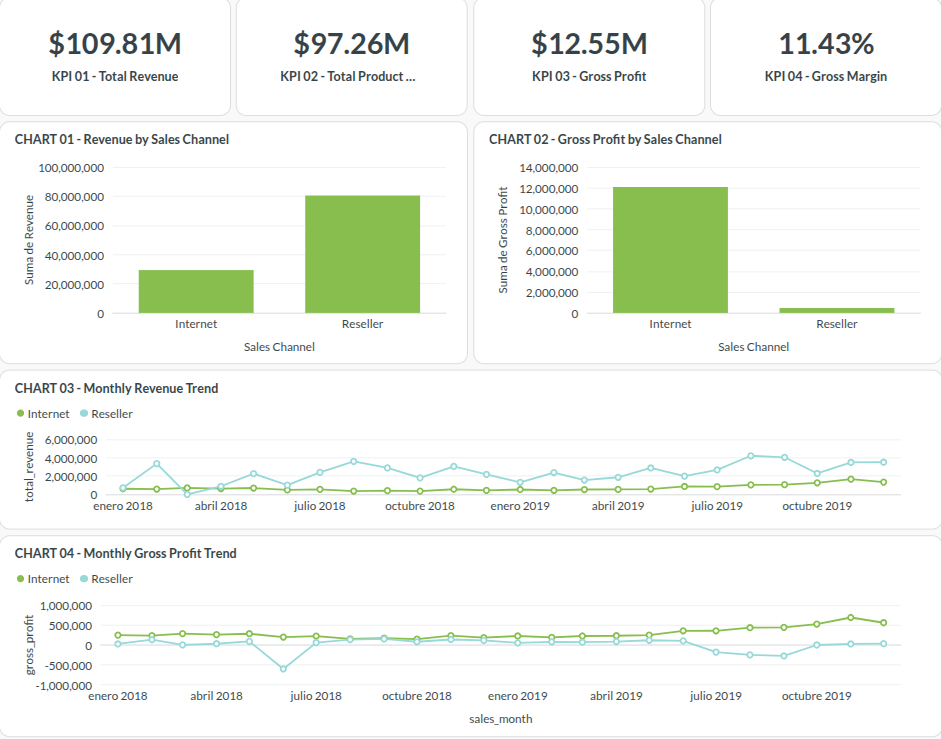
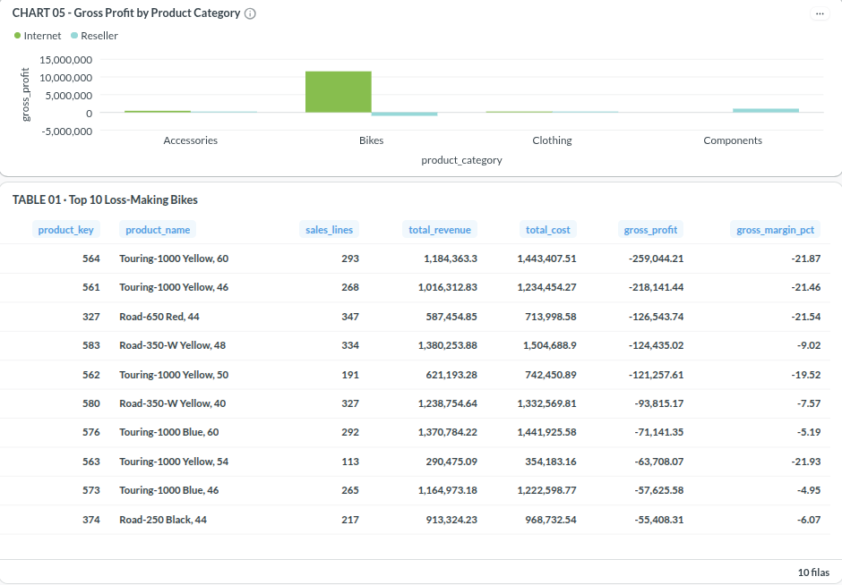
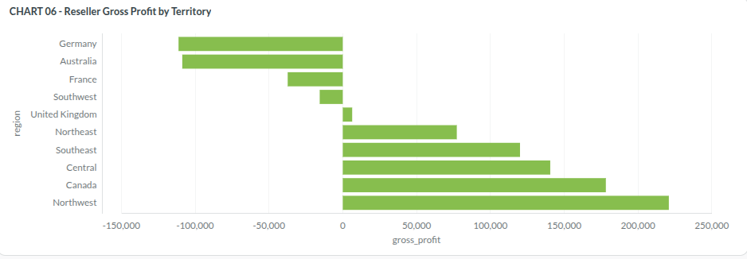

# Revenue & Profitability Intelligence

### End-to-End Financial Analytics & Data Quality Pipeline

A portfolio project that transforms AdventureWorks sales data into a validated analytical model, explores revenue and profitability, and delivers interactive business intelligence dashboards.

The solution combines **Python, PostgreSQL, SQL, dbt Core, Metabase, and systemd** to demonstrate data ingestion, analytical modeling, financial analysis, automated testing, and operational monitoring.

---

## 1. Business Problem

Revenue alone does not provide a complete picture of business performance.

Organizations also need to understand profitability across products, customers, sales channels, geographic territories, and reporting periods.

This project addresses questions such as:

- How do revenue and gross profit evolve over time?
- Which products and territories contribute to profitability?
- How does financial performance differ between sales channels?
- Are source records consistent with their expected financial calculations?
- Can data quality be monitored repeatedly and reliably?

The goal is to build an analytical solution that supports financial reporting while making data quality issues visible.

## 2. Solution Overview

The project implements the following workflow:

```text
AdventureWorks Sales Dataset
             |
             v
     Python Exploration
     & Data Quality Audit
             |
             v
      PostgreSQL RAW
             |
             v
      dbt Staging Models
             |
             v
    dbt Dimensional Marts
             |
             +----------------------+
             |                      |
             v                      v
       Financial SQL          Metabase Dashboards
       & Python EDA                 |
             |                      |
             +----------+-----------+
                        |
                        v
             Quality Monitoring
                        |
                        v
          Execution History & Events
                        |
                        v
              systemd Automation
```

The implementation separates source ingestion, transformation, analytical consumption, and operational validation.

## 3. Technology Stack

| Technology | Purpose |
|---|---|
| Python | Data exploration, ingestion, audits, monitoring, and tests |
| pandas / openpyxl | Excel processing and dataset analysis |
| PostgreSQL | RAW storage and analytical data warehouse |
| SQL | Financial calculations and validation |
| dbt Core | Staging models, dimensional marts, and data tests |
| Metabase | Interactive business intelligence dashboards |
| pytest | Automated Python tests |
| systemd | Scheduled local pipeline execution |
| Git / GitHub | Version control and technical documentation |

Local development was performed on Fedora Linux.

## 4. Dataset and Analytical Model

The project uses the AdventureWorks Sales sample dataset.

The financial source contains **121,253 sales records** covering the period from July 2017 through June 2020.

The workflow starts with dataset profiling and quality auditing before loading data into PostgreSQL.

The dbt project contains **13 SQL models**:

- 7 staging models for source preparation
- 5 analytical dimensions
- 1 sales fact model

The analytical mart follows a dimensional design centered on `fact_sales`, supported by customer, product, reseller, territory, and date dimensions.

This structure supports reusable financial reporting across business dimensions.

See:

- [Dimensional Model Guide](docs/dimensional_model_guide.md)
- [Analytical Model Decisions](docs/analytical_model_decisions.md)
- [Data Dictionary](docs/data_dictionary.md)

## 5. Financial Data Quality Findings

The dataset contains business and data-quality characteristics that require explicit treatment.

### Recorded Revenue Differences

An investigation identified **3,282 sales records** where recorded revenue differs from a basic quantity-times-unit-price calculation.

These differences were associated with the Reseller sales channel and investigated through discount patterns.

They are documented rather than silently overwritten.

### Negative Gross Profit

The financial monitor identifies **21,829 records with negative gross profit**.

These records are retained for business interpretation instead of being automatically removed.

### Reseller Gross Margin

The quality monitor reports a **0.58% reseller gross margin observation**.

This is tracked as a financial warning that requires business context, not as a failed technical test.

### Monitoring Results

The latest validated monitoring summary was:

| Status | Checks |
|---|---:|
| PASS | 4 |
| WARN | 3 |
| FAIL | 0 |

The validated checks cover reconciliation, analytical completeness, required keys, and gross-profit consistency.

See:

- [Data Quality Findings](docs/data_quality_findings.md)
- [Financial Quality Monitoring](docs/financial_quality_monitoring.md)
- [Financial EDA Findings](reports/financial_eda_findings.md)

## 6. Business Intelligence Dashboards

Interactive dashboards were developed in Metabase to explore financial performance through three analytical views.

### Financial Overview

Revenue, gross profit, margins, and performance over time.



### Product Profitability

Product-level profitability and contribution analysis.



### Geographic Analysis

Financial performance across geographic territories.



Additional static figures and analytical summaries are available in [reports/figures](reports/figures).

Dashboard implementation details are documented in the [Metabase Dashboard Guide](docs/metabase_dashboard.md).

## 7. Automated Quality Pipeline

The operational workflow consists of five stages:

1. Run automated Python tests.
2. Check PostgreSQL connectivity and execute dbt.
3. Generate the financial quality report.
4. Archive the report.
5. Compare the latest monitoring results with historical executions.

The pipeline runs through:

```bash
scripts/run_quality_pipeline.sh
```

The execution environment supports unattended operation with a local systemd user service and timer.

The repository includes service and timer templates under:

```text
deploy/systemd/
```

The timer was configured for daily local execution at 09:00. It requires an available user systemd manager and a running computer.

A successful manual execution through systemd has been verified. Automatic timer-triggered execution requires separate observation.

## 8. Reliability and Recovery

The project includes operational controls designed to make failures easier to detect and investigate.

### Structured Execution Events

Each pipeline stage records its status:

- STARTED
- SUCCESS
- FAILED

Execution events contain identifiers, timestamps, stage names, and exit codes.

### Database Connection Preflight

Before dbt execution, the pipeline checks PostgreSQL availability with a read-only query.

Transient connectivity errors may be retried, subject to:

- Maximum 3 attempts
- 2-second delay between attempts
- No automatic retry of failed dbt data-quality tests

Recovery behavior has been validated through simulated failure tests and a successful live database connection.

### Automated Validation

The project has **55 passing Python tests**, validated across two test executions:

- **14 monitoring and reliability tests** cover financial checks, execution events, and bounded connection retries.
- **41 PostgreSQL integration tests** cover RAW data integrity, financial reconciliation, dimensional relationships, and analytical business rules.

The dbt build has also been validated with **59 successful operations**, comprising 13 models and 46 tests.

### Operational History

Six distinct monitoring executions had been archived and recognized at the final Sprint 09 validation.

The monitoring history and execution events are stored locally and excluded from version control.

For operational procedures, see the [Pipeline Operations Runbook](docs/pipeline_operations_runbook.md).

## 9. Repository Structure

```text
.
├── data/                  # Local source and processed datasets
├── deploy/systemd/        # Scheduling templates
├── docs/                  # Architecture and operational documentation
├── models/
│   ├── staging/           # dbt source transformations
│   └── marts/             # Dimensions and sales fact
├── reports/
│   ├── dashboard/         # Metabase screenshots
│   ├── figures/           # Financial analysis outputs
│   └── monitoring/        # Quality reports and local history
├── scripts/               # Ingestion, audits, and automation
├── sql/                   # SQL development and validation
├── tests/                 # Python and SQL testing
├── dbt_project.yml
├── requirements.txt
└── requirements-dbt.txt
```

## 10. Local Setup

This project is a local analytical implementation rather than a hosted public application.

Prerequisites include Python, PostgreSQL, and access to the AdventureWorks Sales sample dataset.

### Python Environment

```bash
python -m venv .venv
source .venv/bin/activate
python -m pip install -r requirements.txt
```

### dbt Environment

A separate environment is recommended:

```bash
python -m venv .venv-dbt
.venv-dbt/bin/python -m pip install -r requirements-dbt.txt
```

### Database and Ingestion

Prepare the PostgreSQL database and RAW schema using the SQL scripts and ingestion instructions supplied in the repository.

See [RAW Ingestion Guide](docs/raw_ingestion_guide.md).

Source data files and local database credentials are not included in the repository.

### dbt Configuration

Configure a local dbt profile named:

```text
revenue_profitability_intelligence
```

The project's tested configuration uses a private profile outside the repository.

Never commit database passwords.

After configuring PostgreSQL and loading the source data:

```bash
.venv-dbt/bin/dbt build \
  --project-dir . \
  --profiles-dir "$HOME/.config/revenue-intelligence-dbt"
```

### Python Tests

Run the standalone reliability and monitoring suite:

```bash
.venv/bin/python -m pytest \
  tests/test_financial_quality_monitor.py \
  tests/test_pipeline_events.py \
  tests/test_database_connection.py -v
```

Other integration-focused tests are also available in the `tests/` directory.

### Operational Scheduling

Review the templates in `deploy/systemd/` and update local project paths before deploying them.

The automated pipeline requires a configured PostgreSQL connection and a credential source.

For setup and troubleshooting, consult:

- [Automated Quality Monitoring](docs/automated_quality_monitoring.md)
- [Operations Runbook](docs/pipeline_operations_runbook.md)

## 11. Engineering Decisions

Several design decisions distinguish this project from a dashboard-only exercise:

**Preserve source evidence.** Financial discrepancies are investigated and documented instead of being automatically corrected.

**Separate transformation layers.** RAW ingestion, staging, and analytical marts have distinct responsibilities.

**Validate financial results.** Reconciliation and quality tests provide evidence of analytical consistency.

**Distinguish warnings from failures.** Unusual business outcomes do not automatically mean the pipeline is broken.

**Track operational executions.** Structured events and historical comparisons support diagnosis.

**Avoid uncontrolled retries.** Connectivity checks use bounded retries while genuine data-quality failures require investigation.

**Keep secrets outside Git.** Credentials and operational execution history remain local.

## 12. Limitations

- The implementation uses a sample dataset, not live production data.
- The dashboards run in a local Metabase environment.
- Pipeline scheduling depends on the local machine and user systemd manager.
- No cloud deployment or external notification system is included.
- Database-outage recovery was simulated rather than tested through an actual service interruption.
- Historical monitoring records are stored locally, not in external durable storage.

## 13. Documentation

| Document | Contents |
|---|---|
| [Business Requirements](docs/business_requirements.md) | Analytical objectives |
| [Data Dictionary](docs/data_dictionary.md) | Source and field definitions |
| [RAW Ingestion Guide](docs/raw_ingestion_guide.md) | Source loading workflow |
| [Dimensional Model Guide](docs/dimensional_model_guide.md) | Analytical model design |
| [Financial Quality Monitoring](docs/financial_quality_monitoring.md) | Monitoring checks |
| [Metabase Dashboard Guide](docs/metabase_dashboard.md) | BI implementation |
| [Automated Quality Monitoring](docs/automated_quality_monitoring.md) | Scheduling |
| [Operations Runbook](docs/pipeline_operations_runbook.md) | Diagnosis and recovery |

---

**Project focus:** Data Analytics · Analytics Engineering · Data Engineering

**Dataset:** AdventureWorks Sales Sample

**Implementation:** Local, reproducible analytical workflow with documented environment requirements.
