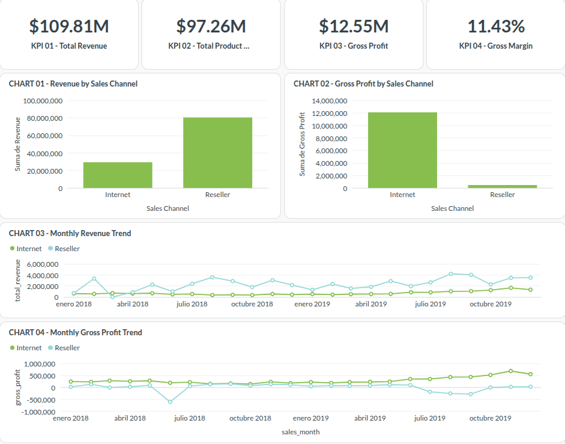
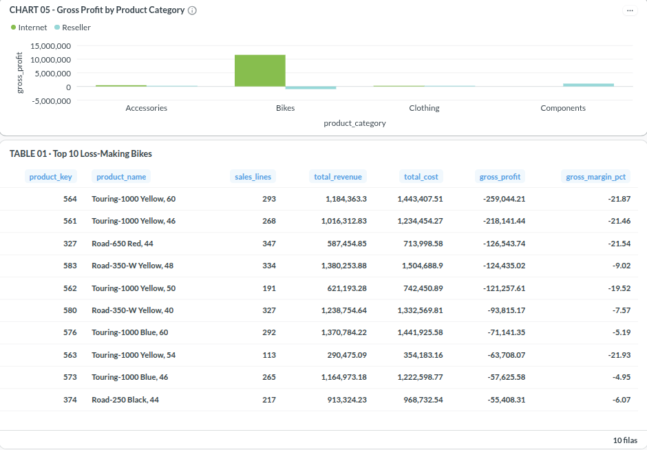
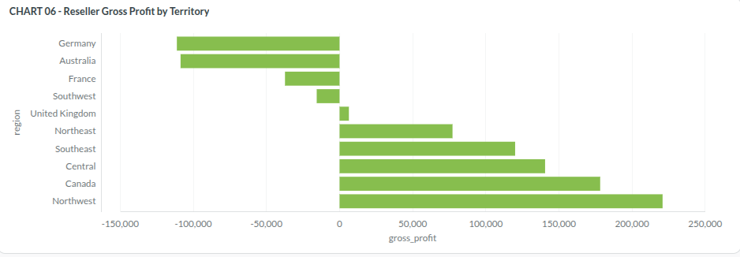

# Executive Financial Dashboard

## Project
Revenue & Profitability Intelligence

## Objective

Build an interactive financial dashboard to evaluate
revenue, product costs, estimated gross profit,
product profitability, and sales territory performance.

## Technology Stack

- PostgreSQL 18
- dbt Core
- Metabase
- Podman
- Fedora Linux
- SQL

## Architecture

AdventureWorks Sales Dataset
    -> PostgreSQL RAW tables
    -> dbt staging models
    -> dbt analytical marts
    -> Metabase
    -> Executive Financial Dashboard

Metabase connects to the revenue_intelligence database
through the metabase_reader PostgreSQL role.

The analytical models are located in the dbt_dev schema.

## Dashboard Structure

### Tab 1 - Financial Overview

Key performance indicators:
- Total Revenue
- Total Product Cost
- Gross Profit
- Gross Margin

Charts:
- Revenue by Sales Channel
- Gross Profit by Sales Channel
- Monthly Revenue Trend
- Monthly Gross Profit Trend

Monthly trends cover the full calendar years 2018-2019.
Months without recorded transactions are represented
with zero recorded revenue or profit.

### Tab 2 - Product Profitability

- Gross Profit by Product Category
- Top 10 Loss-Making Bikes

The analysis identifies product categories and
individual bicycle models with negative gross profit.

### Tab 3 - Geographic Analysis

- Reseller Gross Profit by Territory

The chart compares ten assigned sales territories
using historical Reseller gross profit.

## Historical Financial KPIs

- Total Revenue: $109,809,274.20
- Total Product Cost: $97,257,907.95
- Estimated Gross Profit: $12,551,366.25
- Gross Margin: approximately 11.43%

These metrics cover the complete available dataset,
not only 2018-2019.

Gross margin is calculated as:

    SUM(gross_profit) / SUM(revenue)

It is not calculated as an average of row margins.

## Key Business Findings

1. Reseller generates higher revenue than Internet,
   but contributes relatively little gross profit.

2. Internet maintains substantially higher
   aggregate gross margins.

3. Reseller Bikes exhibit negative aggregate
   gross profit.

4. Several Touring-1000 bicycle variants appear
   among the products with the largest losses.

5. Reseller profitability varies significantly
   across assigned sales territories.

These findings describe observed data patterns.
They do not establish the underlying commercial
or operational causes.

## Dashboard Evidence

### Financial Overview

### Product Profitability

### Geographic Analysis

## Reproducibility and Limitations

The PostgreSQL analytical models are version-controlled
in the repository.

Metabase questions, chart settings, and dashboards are
stored in Metabase's persistent application database,
not automatically in Git.

The screenshots document the visual implementation
but are not a complete Metabase configuration backup.

The dashboard uses the fictional AdventureWorks dataset.

Reported gross profit reflects recorded product costs
and should not be interpreted as net profit.
